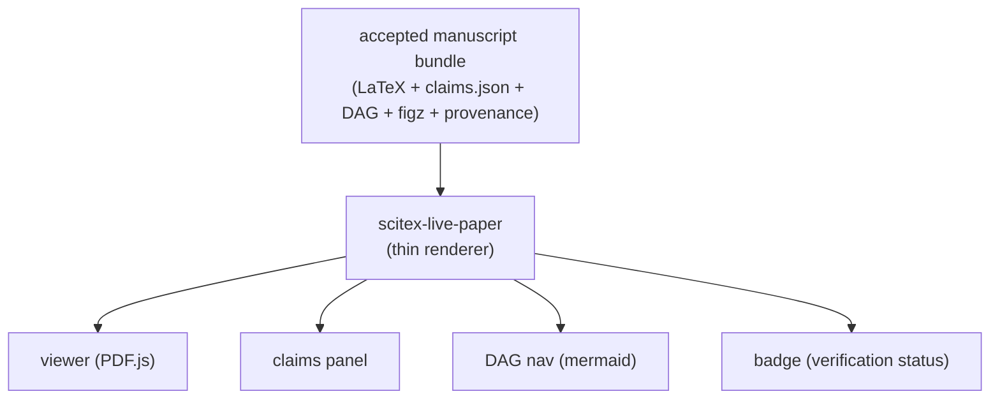

# SciTeX Live Paper (<code>scitex-live-paper</code>)

<p align="center">
  <a href="https://scitex.ai">
    
  </a>
</p>

<p align="center"><b>The web-readable foundation for live, AI-verifiable research papers.</b></p>

<p align="center">
  <a href="https://github.com/ywatanabe1989/scitex-live-paper">Full Documentation</a> · <code>uv pip install scitex-live-paper[all]</code>
</p>

<!-- scitex-badges:start -->
<p align="center">
  <a href="https://pypi.org/project/scitex-live-paper/"></a>
  <a href="https://pypi.org/project/scitex-live-paper/"></a>
  <a href="https://github.com/ywatanabe1989/scitex-live-paper/tree/develop/docs"></a>
</p>
<p align="center">
  <a href="https://github.com/ywatanabe1989/scitex-live-paper/actions/workflows/pytest.yml"></a>
  <a href="https://codecov.io/gh/ywatanabe1989/scitex-live-paper"></a>
</p>
<!-- scitex-badges:end -->

---

## Problem and Solution

| # | Problem | Solution |
|---|---------|----------|
| 1 | **A PDF is dead** — you cannot click a claim, see the code that produced it, re-run it, or check provenance. | **Live-paper renderer** — turns an accepted manuscript bundle into a page where every claim is hash-linked to the executable artefact that produced it. |
| 2 | **Verification rots** — a badge stamped at acceptance says nothing about whether the claims still hold after the code moved on. | **Live re-verify (M2 shipped)** — per-claim and bulk `verify` endpoints call `scitex-clew` against the live project so the badge tracks a continuous re-review cycle. |
| 3 | **Claim-model drift** — every consumer re-defines `Claim` slightly differently until nothing interoperates. | **Deliberately thin consumer** — the claim model is owned upstream by `scitex-clew`; this package reads it, never extends it. |

## Quick Start

```python
from scitex_live_paper import bundle

loaded = bundle.load("./bundle/")
print(len(loaded.claims), "claims,", loaded.paper_state.stage)
```

```bash
# Render the static site (viewer + claims sidebar + DAG + index)
scitex-live-paper render ./bundle/ --out ./site/
```

For a runnable walk-through see [`examples/example_live_paper.py`](examples/example_live_paper.py).

## Demo

A runnable load-and-summarise demo lives in
[`examples/example_live_paper.py`](examples/example_live_paper.py)
(run every example with
[`examples/00_run_all.sh`](examples/00_run_all.sh)):

```bash
python examples/example_live_paper.py
# bundle: bundle-min
# claims: 3
# manuscript: manuscript.pdf
# paper stage: preprint
```

## Installation

```bash
uv pip install "scitex-live-paper[all]"
pip install "scitex-live-paper[all]"
pip install scitex-live-paper           # CLI + library only
```

> **Recommended**: `uv pip install scitex-live-paper[all]` —
> uv's Rust resolver handles the SciTeX dep set in 1-3 min where
> pip's serial backtracker can take 30+ min on the full extras.
> Plain `pip install` still works, as shown above.

<details>
<summary><strong>Extras matrix</strong></summary>

| Extra | Pulls | For |
|-------|-------|-----|
| `django` | `django>=4.2` | standalone `serve` + `scitex-hub` mount |
| `server` | `django>=4.2` + `scitex-sdk[gui]` | `serve` via the SDK workspace shell (superset of `django`) |
| `clew` | `scitex-clew>=0.1.0` | live re-verify (M2) |
| `mcp` | `fastmcp>=2.0` | MCP server for agents |
| `test` | `pytest>=8.0` | test suite |
| `all` | everything above | the one install line operators need |

</details>

<sub><b>Table 1.</b> Optional-dependency extras.</sub>

Without `[clew]` the M2 `api/claim/verify` and `api/claims/verify`
endpoints stay reachable but degrade gracefully (every per-claim
response carries `fallback: true` + a clear reason); install
`[clew]` to get the real `verify_claim()` call.

> **Working on `scitex-live-paper` itself?** See
> [Dev quickstart](docs/dev-quickstart.md) — editable install, render
> the in-tree fixture bundle, bundle-layout contract, and where the
> Django app pattern is mirrored from.

## Architecture

`scitex-live-paper` is **deliberately thin**. It is a **consumer /
rendering layer**, not an authority on claims. If a feature requires
extending the claim or DAG model, **the change belongs upstream in
`scitex-clew`**, not here.



<sub><b>Figure 1.</b> Bundle in, four surfaces out — the package renders, upstream owns the models.</sub>

| Concern | Owner | This package's role |
|---------|-------|---------------------|
| `Claim` data model, `VerificationStatus`, DAG | `scitex-clew` | reads only — never defines, never mutates |
| Hash-linked provenance graph | `scitex-clew` | reads `clew.dag()` / `clew.verify_claim()` outputs |
| Manuscript bundle layout | `scitex-writer` | ingests the bundle as-is |
| Acceptance + re-review verdicts | `scitex-agentic-journal` | receives accepted bundle, surfaces badge |
| Auth / Django app surface | `scitex-hub` | mounted on `/apps/live-paper/` (M3 shipped) |

<sub><b>Table 2.</b> Ownership boundaries — who owns what.</sub>

## Roadmap

| Milestone | Status | Goal |
|-----------|--------|------|
| **M1** | shipped | Read-only static-site renderer for an accepted bundle (CLI) |
| **M2** | shipped | Live re-verify (`api/claim/verify` + `api/claims/verify` + SPA Re-verify button) — see [runbook](docs/dev/m2-reverify-runbook.md) |
| M3 | shipped | Django app on `scitex-hub` at `/apps/live-paper/` + standalone SDK GUI app (`serve`, 0.2.x) |
| M4 | pending | Re-review badge fed from `scitex-agentic-journal` |
| M5 | future | Public DOI landing page (sandbox → Zenodo → JaLC) |

<sub><b>Table 3.</b> Milestone roadmap.</sub>

Issues for M1 are filed in this repo — see [open issues](https://github.com/ywatanabe1989/scitex-live-paper/issues).

## 3 Interfaces

<details open>
<summary><strong>Python API (primary)</strong></summary>

```python
from scitex_live_paper import BundleContext, BundleSource, PaperState, bundle

loaded = bundle.load("./bundle/")
```

</details>

<details>
<summary><strong>CLI</strong></summary>

`scitex-live-paper render ./bundle/ --out ./site/` emits the static
site; `scitex-live-paper serve ./bundle/` boots the standalone SDK
GUI app pinned to a bundle (requires the `[server]` extra); `python -m
scitex_live_paper` works too. Agent-facing surfaces: `scitex-live-paper mcp`
(FastMCP tools projecting the Python API, `[mcp]` extra) and the
`scitex.livepaper.renderers` entry-point group + conformance kit for
external figure/snippet/claim-graph adapters — see
[consumer guide](docs/dev/consumer-integration-guide.md).

</details>

<details>
<summary><strong>Django app</strong></summary>

Mounted under `scitex-hub` at `/apps/live-paper/` (M3 shipped): SPA shell +
`<path:endpoint>` API dispatcher backed by the `HANDLERS` registry.
Host apps inject per-request bundle resolution via
`scitex_live_paper.mount(resolver=...)`. The same engine also runs
standalone: `scitex-live-paper serve ./bundle/` boots the SDK
workspace shell (`scitex_sdk.app.embed.run_standalone`) for local
use, demo, and testability.

</details>

## Environment Variables

| Variable | Set by | Read by | Purpose |
|----------|--------|---------|---------|
| `SCITEX_LIVE_PAPER_BUNDLE` | `serve` CLI / operator | bundle cache | bundle path pinned for the process |
| `SCITEX_CLEW_DB_PATH` | — (retired) | — | retired — clew has no database file |
| `SCITEX_STORE_DSN` | operator | `scitex-clew` | clew's store switch (owned by clew, not this package) |

<sub><b>Table 4.</b> Environment variables referenced by this package.</sub>

## Part of SciTeX

`scitex-live-paper` is part of [**SciTeX**](https://scitex.ai).

Upstream dependencies (this package consumes them; it does not define their models): `scitex-clew` (claim model, DAG, verification), `scitex-writer` (bundle layout + Django viewer pattern), `scitex-hub` (Django host, auth), `scitex-ui` (viewer widgets). Producer: `scitex-agentic-journal` (accepted bundle + re-review verdicts).

>Four Freedoms for Research
>
>0. The freedom to **run** your research anywhere — your machine, your terms.
>1. The freedom to **study** how every step works — from raw data to final manuscript.
>2. The freedom to **redistribute** your workflows, not just your papers.
>3. The freedom to **modify** any module and share improvements with the community.
>
>AGPL-3.0 — because we believe research infrastructure deserves the same freedoms as the software it runs on.

---

## License

AGPL-3.0-only. See [LICENSE](LICENSE).

---

<p align="center">
  <a href="https://scitex.ai" target="_blank"></a>
</p>
