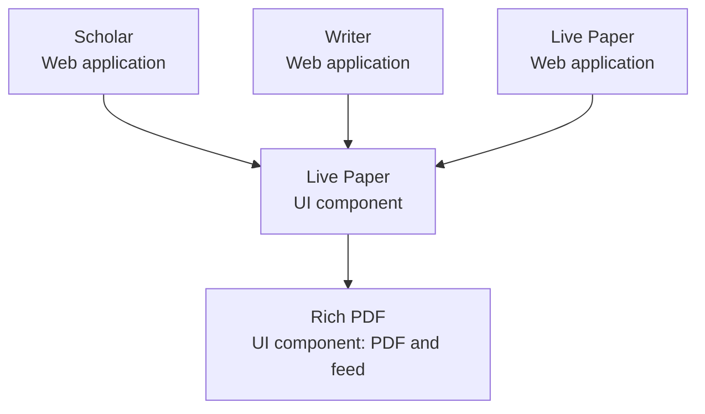
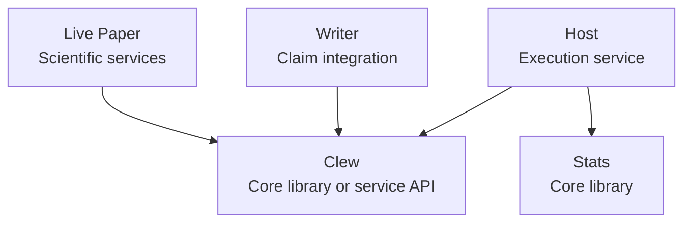

# SciTeX Scientific Paper Architecture

Architecture design · 20 November 2026

**Rich PDF owns the PDF and its synchronized feed. Live Paper supplies scientific content and actions.** Scholar and Writer embed Live Paper through small connectors. Stats produces statistical results and receipts; Clew connects registered claims to those results and their recorded computations.

This is the canonical paper-workflow architecture in `scitex-live-paper`. Sphinx and the architecture skill read this same source. It covers the reading, authoring, computation, evidence, and publication boundaries; related packages retain their own API and operations documentation.

## Terms

**Library or application describes how software is used. GUI, CLI, TUI, and API describe how it is accessed.** One repository can provide a library, an application, and several interfaces.

An application may expose a GUI, CLI, or both. A library may provide headless functions or reusable GUI components.

| Term | Meaning here |
| --- | --- |
| Core library | Reusable domain logic called through a public API |
| UI component | Reusable graphical functionality embedded in an application |
| Application | A runnable experience with an entry point, host context, and user workflow |
| GUI | A graphical user interface, including a web application |
| CLI | A command-line interface: commands and arguments in a terminal |
| TUI | An interactive terminal interface with screens, panels, or menus |
| API | A programmatic interface, such as Python functions, a JavaScript component API, or HTTP endpoints |

Use **CLI** for command-line tools. Use **TUI** when describing an interactive terminal screen. CUI is less specific and is unnecessary for this architecture.

## GUI composition

> **Diagram legend:** A → B means **A uses B** through a public interface. All arrows are solid. Box subtitles identify applications, UI components, libraries, or services. In this diagram, uses means embeds a UI component.

Scholar and Writer embed the Live Paper component; Live Paper's standalone application embeds that same component.

Live Paper has both an embeddable component and an application shell. Its embedding API exposes the component. Rich PDF is a UI component library, which can be used by other applications as well.

## Core libraries and services

> **Diagram legend:** A → B means **A uses B** through a public API. All arrows are solid. Here, uses means calls a library or service through a connector. Artifact transfer appears in the numbered workflow.

The execution service invokes Stats for authorized computation and records runs in Clew.

The Live Paper backend uses its optional Clew connector. Writer uses its claim registration connector. A connector can call a library locally or an authorized service API without changing the viewer. Stats returns result artifacts and receipts, which the author can reference from Writer. Artifact movement is described in the workflow below rather than drawn as a second kind of arrow.

SDK supplies shared UI and PDF primitives plus the contracts for host capabilities. Each application's GUI and CLI can call its own core library. Keeping the component separate from the application shell allows reuse without bringing the shell's navigation into another app.

## Package responsibilities

| Repository | Owns |
| --- | --- |
| `scitex-rich-pdf` | Neutral PDF viewer and feed: rectangles, annotations, selection, scrolling, and generic action controls |
| `scitex-live-paper` | Scientific content: claim cards, graph previews, result details, reproduction workflows, and integration contracts |
| `scitex-clew` | Authoritative claim registry, recorded runs, provenance graphs, and evidence checks |
| `scitex-scholar` | Paper discovery, library records, bibliographic metadata, citations, reading notes, and its Live Paper connector |
| `scitex-writer` | Manuscript sources, claim insertion, formatting, compilation, PDF anchors, and its Live Paper connector |
| `scitex-stats` | Statistical methods, result schemas, receipts, and numerical verification rules |

Rich PDF uses the SDK's PDF rendering and coordinate transforms. Its feed supports comments, review notes, and scientific cards. Live Paper integrates Clew through its connector and accepts other providers through the same public interfaces. Clew uses SDK for its GUI; its core operates independently of SDK and Django.

| Package | Reusable surface | Application interfaces |
| --- | --- | --- |
| Rich PDF | JavaScript UI component and public viewer/feed API | The component appears inside a host GUI |
| Live Paper | Scientific services, connectors, and embeddable UI component | Standalone web GUI, CLI, and programmatic APIs |
| Clew | Claim, provenance, and verification core API | CLI and optional web GUI |
| Scholar | Search, library, and bibliography APIs; Live Paper connector | CLI and web GUI |
| Writer | Manuscript, compilation, and claim APIs; Live Paper connector | CLI and web GUI |
| Stats | Statistical computation, result, and verification APIs | CLI and web GUI |

These rows describe the target separation; existing foundations and planned work are distinguished in the implementation sequence. A web GUI, CLI, and API are multiple entry points to the same capabilities, not separate claim or result stores.

## One PDF and one feed

The main view has a PDF beside a synchronized feed. Selecting a rectangle selects its entry; selecting an anchored entry scrolls to its PDF region. Entries with unresolved locations remain available in the feed.

Rich PDF owns layout, selection, keyboard interaction, hover containers, and generic action buttons. Injected content renderers and handlers receive region selection, entry selection, hover, and action requests.

Live Paper supplies the meaning of scientific entries: stated values, source values, evidence states, graph previews, and available actions. Hover or keyboard focus shows a compact claim graph. A selected card provides access to the full authorized graph and deeper details. Reproduction starts through an explicit action.

Live Paper renders graphs inside Rich PDF's containers. The same content works in standalone Live Paper, Scholar, and Writer. Features appear according to available content and capabilities.

## Public interfaces

Keep four small interfaces; connectors translate provider APIs into these contracts.

| Interface | Information or operations |
| --- | --- |
| Document | Stable document identity, PDF source, revision hash, metadata, and access capabilities |
| Feed | Entry identity, optional document target, display content or renderer, comments, actions, and selection events |
| Evidence | Project-qualified claim reference, stated and source values, check outcomes, reasons, artifact references, and pruned or full graph data |
| Actions | Available operations, explicit invocation, progress, result, and cancellation when supported |

The document and feed interfaces belong to Rich PDF. Live Paper defines the scientific evidence interface and the semantics of its scientific actions. The host provides authorized document access, persistence, and execution; credentials remain on the server.

Reuse the public PDF coordinate contract and Live Paper evidence-report schema, preserving existing adapters and exports during migration. Additional scientific fields and capabilities remain optional.

## Connector ownership

Connectors are modules in their owning repositories and use public APIs.

| Connector | Lives in | Adapts |
| --- | --- | --- |
| Scholar to Live Paper | Scholar | Selected paper, authorized PDF, bibliographic metadata, reading notes, and citation actions |
| Writer to Live Paper | Writer | Compiled PDF, document revision, claim occurrences, annotations, and navigation back to source |
| Live Paper to Clew | Live Paper | Claims, evidence outcomes, artifact references, and provenance graphs into scientific content |
| Writer to Clew | Writer | Claim creation and updates into the authoritative claim registry |

Stats supplies result artifacts and receipts. The execution service invokes its verification or recomputation APIs when an authorized action requests them.

Scholar and Writer consume Live Paper's embedding API. Live Paper composes Rich PDF internally. Connector modules can remain small without separate connector repositories.

## From a statistical result to a paper

1. **Prepare and compute.** Template establishes the project layout, Scholar supplies references, and Dataset supplies inputs and acquisition records. Session manages the analysis lifecycle. Stats returns results and receipts; FigRecipe records figure recipes. I/O persists artifacts, and Clew subscribes to recording hooks to connect the run, inputs, outputs, and environment.
2. **Author.** The author inserts a claim through Writer. The claim references the result artifact, the exact field or locator, the recorded run when available, and the comparison rule. Clew stores the registered claim.
3. **Compile.** Writer formats the claim for the manuscript and emits the PDF plus an anchor map for that PDF revision. Each displayed occurrence can have its own region.
4. **Read.** Scholar or Writer opens the same Live Paper component. Its Clew connector supplies evidence, and Rich PDF displays the rectangles and synchronized feed.
5. **Reproduce.** An explicit action requests an authorized job. The execution service produces a new run and artifacts, evaluates the declared comparisons, and returns fresh evidence to Live Paper.
6. **Publish and review.** Agentic Journal supplies submission, review, publication, and lifecycle metadata through its ports and bundle references. Live Paper presents the paper and evidence in that lifecycle context.

Stats owns numerical checks. Clew owns checks of claims and recorded computational dependencies. Live Paper presents the individual outcomes, including whether a fresh rerun actually completed and matched.

## Identities and persistence

Join the components using project-qualified claim IDs, artifact hashes and locators, recorded run IDs, and PDF revision hashes.

A PDF anchor contains document identity and revision, an occurrence ID, an optional claim reference, page number, and rectangles. Pages start at 1; rectangles use bottom-left PDF coordinates in PDF units. Text context or a named PDF destination can help locate content; ambiguous matches stay unresolved.

Recompilation creates a new document revision and anchor map. Feed entries keep their claim references while locations resolve against the new revision. Repeated mentions retain separate occurrence identities.

Clew remains the claim registry. Writer's claim files and exported evidence reports are derived snapshots. The host persists comments and notes through the relevant connector. A viewer cache holds presentation data for a particular document revision.

## Related packages

These packages connect through public APIs, artifacts, hooks, or host services. Their presence in this workflow does not make them mandatory Live Paper dependencies.

| Package | Connection to the paper workflow |
| --- | --- |
| `scitex-sdk` | Shared App/UI contracts, reusable PDF primitives, host capability interfaces, and mounting. SDK is the canonical owner of the shared App/UI surface. |
| `scitex-hub` | Web host, identity, authorized project and resource resolution, persistence, and job integration. It mounts package-owned applications. |
| `scitex-session` | Public session decorator and lifecycle hooks. Clew subscribes to record computations while Session remains independent of the observer. |
| `scitex-io` | Load/save APIs, artifact formats and bundles, and observation hooks for provenance recording. |
| `scitex-dataset` | Dataset discovery, acquisition records, file manifests, and replayable input retrieval. |
| `figrecipe` and `scitex-plt` | Figure recording, saved recipes, and reproduction. `scitex-plt` is a compatibility alias for FigRecipe rather than a second figure engine. Figure details enter Live Paper through its figure port. |
| `scitex-template` | Project creation and research layout, including Scholar and Writer integration. |
| `scitex-hpc` | Scheduler-neutral planning, submission, status, and cancellation for authorized compute jobs. |
| `scitex-container` | Docker/Apptainer environments and container lifecycle for declared execution backends. |
| `scitex-agent-container` | Agent orchestration when a workflow calls for an agent. The execution host chooses the backend for a job. |
| `scitex-agentic-journal` | Submission and publication lifecycle, review outcomes, and published bundle references through its own ports and host resolver adapter. |
| `scitex-notebook` | Notebook verification and conversion, contributing executable artifacts and their provenance. |
| `scitex-browser` | Browser automation used for scholarly access and acquisition; the PDF viewer remains a separate component. |
| `scitex` from `scitex-python` | User-facing umbrella namespace and convenience interfaces over packages. Package integrations call the owning leaf's public API. |
| `scitex-dev`, `scitex-config`, and `scitex-logging` | Shared development, documentation/skill discovery, configuration, and logging infrastructure. Domain ownership stays with the relevant packages. |

For reproduction, Live Paper requests an action from the execution host. The host selects the configured local, container, or HPC route, records the new run through Session/Clew, and returns fresh result artifacts. Optional agent orchestration uses the same declared job boundary.

The existing source provides Session and I/O recording hooks, Dataset file manifests, FigRecipe recipe APIs, HPC compute APIs, and Journal ports. Connecting all of them into one accepted Live Paper workflow remains integration work. The six-package reading/authoring boundary above is the target design.

## Implementation sequence

| Step | Deliverable |
| --- | --- |
| 1 | Extract the neutral PDF provider into `scitex-rich-pdf`, including the generic synchronized feed, while retaining compatibility exports in Live Paper |
| 2 | Expose the Live Paper embedding API and its scientific content and action adapters |
| 3 | Extend Writer's existing Live Paper adapter with document revisions, claim occurrences, and source navigation |
| 4 | Add Scholar's Live Paper connector for selected library papers |
| 5 | Connect Stats result details and authorized verification or reproduction actions through the evidence and execution interfaces |

Existing foundations include SDK PDF primitives, Live Paper's injectable overlay/comment provider and evidence-report contract, Writer's Clew claim registration, and Stats verification APIs. Writer already wraps Live Paper's PDF provider; Scholar's library details pane shows metadata. The extraction, shared feed, richer connectors, and complete PDF evidence workflow remain to be implemented.

Acceptance should demonstrate the same PDF and feed in standalone Live Paper, Scholar, and Writer; selection in both directions; a claim-specific graph preview; unresolved and repeated claim locations; correct behavior after recompilation; persisted comments; and an explicit rerun that reports fresh comparison results. Existing project authorization and tenant isolation must continue to hold.
